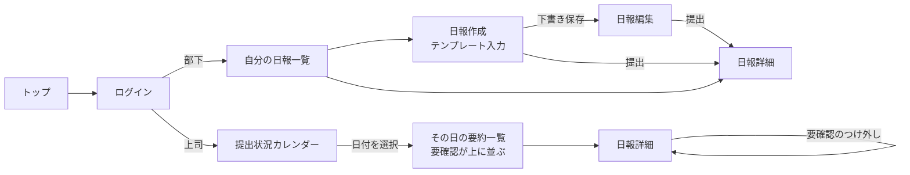
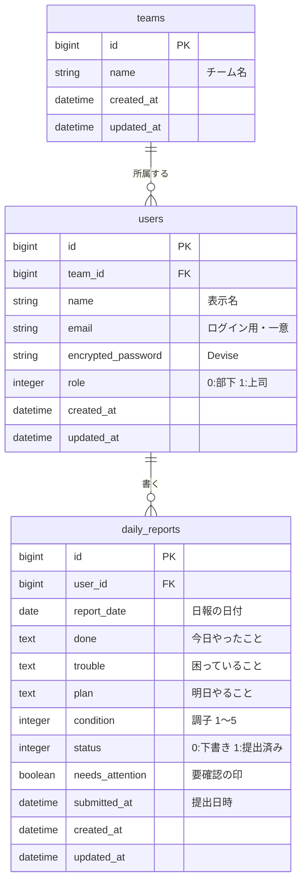

# ひとめ日報 — 上司のための日報ひと目チェックアプリ

> 部下10人分の日報チェックを、毎朝30分から5分へ。

## 目次

1. [サービス概要](#1-サービス概要)
2. [このアイデアはどこから生まれたか](#2-このアイデアはどこから生まれたか)
3. [課題の整理](#3-課題の整理)
4. [想定ユーザー](#4-想定ユーザー)
5. [既存サービス・競合調査](#5-既存サービス競合調査)
6. [このサービスで提供したい価値](#6-このサービスで提供したい価値)
7. [このアプリで実現すること](#7-このアプリで実現すること)
8. [このアプリの懸念点とその対策](#8-このアプリの懸念点とその対策)
9. [今後の展開・発展の方向性](#9-今後の展開発展の方向性)
10. [技術スタック](#10-技術スタック)
11. [画面遷移図](#11-画面遷移図)
12. [ER図](#12-er図)
13. [実装の設計](#13-実装の設計)
14. [環境構築の手順](#14-環境構築の手順)
15. [開発ルール](#15-開発ルール)

---

## 1. サービス概要

部下の日報を「要約」と「要確認の印」でひと目で把握できる、上司のための日報管理アプリです。
部下はテンプレートに沿って日報を書き、上司はカレンダーで日付ごとに全員の要約を確認して、気になる人だけ詳しく読めます。
毎朝30分以上かかっていた日報チェックを、5分に短くします。

---

## 2. このアイデアはどこから生まれたか

### 2-1. きっかけとなった体験・感情

アルバイト先で、店長が閉店後に全スタッフの業務報告を1件ずつ読み、その後に翌日のシフト調整をしていました。報告の書き方は人によってバラバラで、長い報告の最後に「お客様から苦情があった」と一行だけ書かれていたことに、店長が数日後まで気づかなかったことがあります。
そのとき、「報告はちゃんと上がっていたのに、届いていなかった」というもどかしさを感じました。

### 2-2. なぜそれが「気になった」のか

チームで動くとき、誰かの小さな困りごとが見過ごされることに、もともと敏感だからだと思います。
「書いた人も読む人も頑張っているのに、仕組みのせいで報われない」状態をなくしたい、という価値観につながっています。

---

## 3. 課題の整理

### 3-1. 表に見えている困りごと

部下全員分の日報を毎日読むのが大変です（部下10人で毎朝30分以上）。

### 3-2. 本当に解決したい課題

- なぜ困る？ → 読むのに時間がかかり、上司自身の業務の時間が削られる
- なぜ？ → 書き方が人によってバラバラで、要点を探しながら読むしかない
- なぜ？ → 読み流すうちに、トラブルや不調のサインを見落としてしまう

→ 本当に解決したい課題：**上司が、気にかけるべき部下のサインに、時間をかけずに気づけていないこと**

---

## 4. 想定ユーザー

### 4-1. 想定しているユーザー

部下10人を抱える、40代の課長Bさん。

| 項目 | 内容 | 理由 |
| --- | --- | --- |
| 年齢 | 40代 | 部下を10人ほど持つ課長クラスの年代。プレイングマネージャーとして自分の業務も抱えているため、日報を読む時間を確保しにくい |
| 生活・状況 | 毎朝、始業後に部下10人分の日報を確認してから自分の仕事に入る | 要約と「要確認」の印があれば、全員分を読む前に誰から見るべきかがわかる |
| 環境 | 日報が自由記述で、人によって長さも書き方も違う職場 | テンプレートで書き方をそろえ、要約しやすく・読みやすくする |

### 4-2. 自分とユーザーの距離

**身近な誰か**（アルバイト先の店長・家族の上司など）。
私たち3人はまだ部下を持つ立場ではありませんが、報告を「書く側」としては日々経験しています。書く側から見て「この報告、ちゃんと読まれているのかな」と感じた経験が、読む側の課題を想像する手がかりになっています。
開発中は、アルバイト先の店長など身近な「読む側」の人に画面を見てもらい、想定とのズレを確かめます。

### 4-3. 実際に使われる可能性

| 項目 | 内容 |
| --- | --- |
| 最初に使ってくれそうな人 | 部下を10人ほど持つ課長・店長 |
| 思い出す場面 | 朝、日報を確認しようとしたとき |
| 今の代わりに使っているもの | メール・チャット・スプレッドシートに上がった日報を1件ずつ読む |
| 置き換えてまで使う理由 | 全員分を読まなくても、誰を先に見るべきかがわかる |

### 4-4. 導入から継続までの流れ

- **きっかけ**：部下が増えて、日報チェックが回らなくなったとき
- **最初の一歩**：上司がチームを作って部下を招待し、部下はテンプレートで日報を書き始める
- **使い続ける理由**：毎朝の確認が短くなることを、毎日実感できる
- **toBとしての懸念**：業務の日報は機密を含むため、個人開発のサービスには登録しにくい → 今回はデモデータで動かし、本番利用に必要な権限管理・セキュリティは今後の展望で扱う

---

## 5. 既存サービス・競合調査

### 5-1. 似たサービスの調査

| サービス名 | URL | どんなことができるか |
| --- | --- | --- |
| gamba! | https://www.getgamba.com/ | テンプレート入力、ファイル添付、Googleカレンダー連携、KPI管理、コメント・いいね・スタンプ。SNSのような操作感で日報を確認できる |
| 日報アプリ（株式会社MOTOMURA） | https://info.nippou.jp/ | テンプレート作成、提出状況の確認、コメント、AIによる日報サマリー生成、AI翻訳 |

出典：[gamba!（アイミツSaaS）](https://saas.imitsu.jp/cate-dailyreport/service/2332)、[日報アプリ（ITreview）](https://www.itreview.jp/products/nippou/profile)（2026-10-25確認）

### 5-2. それでも自分たちが作りたい理由

既存サービスは「書く・共有する・コミュニケーションを取る」ことを中心にしていて、機能が多いぶん、読む側は結局1件ずつ開くことになります。AI要約があるサービスも、要約は読む量を減らすだけで、「今日誰に声をかけるべきか」までは教えてくれません。
私たちは、上司が朝一番に知りたいのは「全員の内容」ではなく「気にかけるべき人は誰か」だ、と考えました。

### 5-3. 差別化を「体験価値」で表現する

| | 既存サービス | ひとめ日報 |
| --- | --- | --- |
| 中心にある体験 | 書く・共有する・やりとりする | 読む側が「誰から見るか」を決める |
| 朝の確認 | 全員分を順番に開く | 「要確認」の人から開く |
| 機能の量 | 多機能 | 「気づく」ために必要な機能だけ |

**部下10人を持つ課長が、朝5分で「今日声をかけるべき人」がわかる** — これが私たちの差別化ポイントです。

---

## 6. このサービスで提供したい価値

### 6-1. ユーザーの変化

| | Before | After |
| --- | --- | --- |
| 行動 | 全員分を順番に読む | 「要確認」の人から読む |
| 気持ち | 「全部読まなきゃ」という負担感 | 必要な人に集中できる安心感 |
| 考え方 | 日報は「チェックする作業」 | 日報は「部下の変化に気づくきっかけ」 |

### 6-2. 価値を一文で表す

**このサービスは、部下を多く抱える上司が、日報を短時間で把握し、気にかけるべき部下にすぐ気づけるようになるサービスです。**

---

## 7. このアプリで実現すること

### MVPで作る機能

| 機能 | 内容 | 使う人 |
| --- | --- | --- |
| ログイン | 上司／部下の役割でできることを分ける | 全員 |
| 日報の作成・提出 | 「今日やったこと／困っていること／明日やること／調子（5段階）」のテンプレートで入力。下書き保存も可能 | 部下 |
| 日報の要約一覧 | 日付ごとに全員分の日報を1行ずつ並べる。要約は「やったこと」の先頭部分を表示し、AI要約の見せ方をモックで再現 | 上司 |
| 「要確認」の印 | 「困っていること」に記入がある、または調子が2以下の日報に自動で印をつけ、一覧の上に並べる。上司が手動でつけ外しもできる | 上司 |
| 日報の詳細表示 | 1件の日報を全文で読む | 上司・部下 |
| 提出状況カレンダー | 月表示で、日付ごとの提出数・未提出者・要確認数を表示。日付を押すとその日の要約一覧へ | 上司 |

> 「要確認」の判定はMVPではルールベース（記入内容と調子の値）で行い、本リリースでAIによる判定に置き換えます。

### 本リリースで作る機能

- AIによる本物の要約と、「要確認」の自動判定
- 日中メモの仮置き（部下が書きたいことをその場でメモしておき、日報作成時に取り込む）
- 上司からのコメント・提出リマインド通知・調子の推移グラフ
- 最低限のアクセシビリティ対応（文字サイズ・配色）

---

## 8. このアプリの懸念点とその対策

### 懸念点①：時間が減ることをデモで伝えきれない

- **何が問題になりそうか**：要約がモックなので、本当に時間が短くなるかが伝わりにくい
- **なぜそう思うか**：今回はAI APIを使わない判断をしたため
- **対策**：デモデータで「全文を読む場合」と「要約＋印で読む場合」を並べて見せ、かかる時間の差を体感してもらう

### 懸念点②：業務データを登録してもらえない

- **何が問題になりそうか**：業務日報は機密情報を含み、個人開発のサービスに登録しにくい
- **なぜそう思うか**：toBサービスでは、導入判断の時点でセキュリティを問われるため
- **対策**：今回はデモデータのみで動かす。今後の展望で、権限管理（チーム外の日報は見えない・部下は自分の日報だけ）とデータの扱い方針を示す

---

## 9. 今後の展開・発展の方向性

- **ユーザーはなぜ使い続ける？**：毎朝の確認時間が短くなることを毎日実感できるから
- **データが溜まると何ができる？**：部下ごとの調子の波や、トラブルが起きやすい時期に気づける
- **他の人と関わる余地**：上司から部下へのひと言フィードバックで、日報が「出して終わり」にならない

### 今考えている発展案

- **機能追加の方向性**：AI要約、要確認の自動判定、日中メモ、コメント・通知、傾向グラフ
- **UI・体験の改善**：ITが苦手な人でも迷わない画面、最低限のアクセシビリティ
- **機能以外の工夫**：日報テンプレートの書き方ガイドを用意し、要約しやすい日報を書く習慣をつくる

### 本リリース以降の全体像

MVPでは `teams` / `users` / `daily_reports` の3テーブルだけを作る。
下図の招待・メモ・コメント・通知・AI列は本リリースで追加する。

[](https://gyazo.com/e3916ff75a63fe6194c041db1de5fd49)

---

## 10. 技術スタック

### 10-1. 使用技術

| 分類 | 技術 |
| --- | --- |
| 言語・フレームワーク | Ruby 3.3 / Ruby on Rails 7.2 |
| DB | PostgreSQL 16（本番は Neon でホスティング） |
| 開発環境 | Docker Compose |
| デプロイ | Render |
| 認証 | Devise |
| カレンダー表示 | simple_calendar |
| 日本語化 | rails-i18n / devise-i18n |
| Lint | RuboCop |
| タスク管理 | GitHub Projects |

### 10-2. 技術選定の比較検討

| 候補 | 採用／不採用 | 理由 |
| --- | --- | --- |
| Ruby on Rails | 採用 | RUNTEQで3人とも学んでいて、2週間で作りきれる |
| PostgreSQL | 採用 | Renderと相性がよく、RUNTEQの課題でも使っている |
| MySQL | 不採用 | 使えるが、デプロイ先との相性でPostgreSQLにそろえた |
| Neon | 採用 | PostgreSQLのみが必要で、無料枠の範囲で十分。認証やストレージまで含むSupabaseは今回の用途には大きすぎる |
| Docker Compose | 採用 | 3人の環境の違いで詰まらないようにする |
| Devise | 採用 | ログイン・ログアウト・パスワード管理を短期間で安全に用意できる |
| simple_calendar | 採用 | 月表示カレンダーを自前で組むより早く、日付ごとの表示を柔軟にカスタマイズできる |
| Pundit（権限のgem） | 不採用 | 役割が2つ・画面が7つなら、`before_action` と「見てよい範囲から探す」書き方で足りる。覚えることを増やさない |
| AI API（OpenAIなど） | 今回は不採用 | API連携と利用料の管理まで入れると、2週間でMVPが間に合わない |

### 10-3. 今回チャレンジしたい点・不安な点

- **チャレンジ**：チームでのGitHub Flow（ブランチ・PR・レビュー）を最後まで回しきること
- **不安な点と対策**
  - カレンダー表示 → simple_calendar を使い、まず「日付ごとの提出数を出すだけ」の最小形から作る
  - 上司／部下の権限の分け方 → `users.role`（enum）で役割を持たせ、コントローラの `before_action` で上司専用画面を制限する。日報は**書いた人（users）の `team_id`** で絞り込み（`team.daily_reports`）、他チームのデータが見えないようにする。詳しくは13-5

---

## 11. 画面遷移図



| 画面 | パス | 閲覧できる人 |
| --- | --- | --- |
| トップ | `/` | 全員 |
| ログイン | `/users/sign_in` | 全員 |
| 提出状況カレンダー | `/calendar` | 上司 |
| その日の要約一覧 | `/daily_reports?date=YYYY-MM-DD` | 上司 |
| 自分の日報一覧 | `/my/daily_reports` | 部下 |
| 日報作成・編集 | `/daily_reports/new`, `/daily_reports/:id/edit` | 部下（本人のみ・編集は下書きのみ） |
| 日報詳細 | `/daily_reports/:id` | 上司（同じチーム・提出済みのみ）・部下（本人のみ） |

---

## 12. ER図



- `daily_reports` は `[user_id, report_date]` にユニーク制約をつけ、1人1日1件にする
- `needs_attention` は提出時に「`trouble` に記入がある、または `condition` が2以下」で自動的に `true` になり、上司が手動で切り替えることもできる
- 日報には `team_id` を持たせない。チームの日報は「日報 → 書いた人 → チーム」とたどる（`Team has_many :daily_reports, through: :users`）
- チームの作成・招待はMVPではシードデータで用意し、招待機能は本リリースで追加する

---

## 13. 実装の設計

> この章は「3人が同じ名前で話せるようにするための約束」です。ここに書いた名前（ルート、メソッド、変数）は、変えるときは定例で共有してからにします。

### 13-1. 全体の流れと担当

```
ブラウザ ─▶ ルーティング ─▶ コントローラ ─▶ モデル ─▶ DB
                │                │              │
                │       権限チェック(A)    保存・判定(B)
                ▼                ▼
             ビュー(C) ◀── インスタンス変数（13-6の受け渡し表）
```

| 担当 | 持つところ | ひとことで |
| --- | --- | --- |
| A 土台と権限（Kou） | Rails雛形・Docker・Devise・`User`/`Team`・`ApplicationController`の権限・デプロイ・CI | 入口で「誰か」を確かめ、見てはいけないものを見せない |
| B データと処理（ステファノ） | `DailyReport`・ルーティング・各コントローラのアクション・シード | 日報を保存して、要確認の印をつけ、画面に渡すデータを用意する |
| C 見た目（もー） | `app/views` 全部・CSS（`mock/` から移植） | Bが渡した変数を、モックどおりの画面にする |

### 13-2. ディレクトリ構成（作るファイルと担当）

```
app/
├── controllers/
│   ├── application_controller.rb      … A  ログイン必須・権限・ログイン後の行き先
│   ├── static_pages_controller.rb     … B  top
│   ├── daily_reports_controller.rb    … B  index/show/new/create/edit/update/toggle_attention
│   ├── calendars_controller.rb        … B  show
│   └── my/
│       └── daily_reports_controller.rb … B  index（自分の日報一覧）
├── models/
│   ├── team.rb                        … A
│   ├── user.rb                        … A  （visible_daily_reports も A）
│   └── daily_report.rb                … B
├── views/                             … すべて C
│   ├── layouts/application.html.erb   … 共通ヘッダー・フラッシュ
│   ├── devise/sessions/new.html.erb   … ログイン
│   ├── static_pages/top.html.erb
│   ├── daily_reports/
│   │   ├── index.html.erb             … その日の要約一覧
│   │   ├── _report_card.html.erb      … 一覧の1行（印・要約）
│   │   ├── show.html.erb              … 日報詳細（上司・部下で1つ）
│   │   ├── new.html.erb / edit.html.erb
│   │   └── _form.html.erb             … テンプレート入力
│   ├── calendars/show.html.erb
│   ├── my/daily_reports/index.html.erb
│   └── simple_calendar/_month_calendar.html.erb … カレンダーの見た目
└── assets/stylesheets/application.css … C  mock/style.css を移す
config/
├── routes.rb                          … B
├── application.rb                     … A  タイムゾーン・日本語
└── locales/ja.yml                     … B  モデルの項目名（日本語）
db/
├── migrate/                           … A: teams, users ／ B: daily_reports
└── seeds.rb                           … B
```

### 13-3. ルーティング

```ruby
# config/routes.rb
Rails.application.routes.draw do
  devise_for :users, skip: :registrations   # 新規登録はMVPでは作らない（シードで用意）
  root "static_pages#top"

  resources :daily_reports, only: %i[index show new create edit update] do
    patch :toggle_attention, on: :member      # 要確認のつけ外し（上司）
  end

  resource :calendar, only: :show             # /calendar（上司）

  namespace :my do
    resources :daily_reports, only: :index    # /my/daily_reports（部下）
  end
end
```

| メソッド | パス | コントローラ#アクション | ヘルパー | 誰が |
| --- | --- | --- | --- | --- |
| GET | `/` | `static_pages#top` | `root_path` | 全員 |
| GET | `/users/sign_in` | `devise/sessions#new` | `new_user_session_path` | 全員 |
| DELETE | `/users/sign_out` | `devise/sessions#destroy` | `destroy_user_session_path` | ログイン中 |
| GET | `/calendar` | `calendars#show` | `calendar_path` | 上司 |
| GET | `/daily_reports?date=` | `daily_reports#index` | `daily_reports_path(date:)` | 上司 |
| PATCH | `/daily_reports/:id/toggle_attention` | `daily_reports#toggle_attention` | `toggle_attention_daily_report_path(r)` | 上司 |
| GET | `/daily_reports/:id` | `daily_reports#show` | `daily_report_path(r)` | 上司・本人 |
| GET | `/my/daily_reports` | `my/daily_reports#index` | `my_daily_reports_path` | 部下 |
| GET / POST | `/daily_reports/new`, `/daily_reports` | `new` / `create` | `new_daily_report_path` | 部下 |
| GET / PATCH | `/daily_reports/:id/edit`, `/daily_reports/:id` | `edit` / `update` | `edit_daily_report_path(r)` | 部下（本人の下書き） |

> モックの「完了」画面（done.html）は作らず、提出後は日報詳細へ移動して「日報を提出しました」とフラッシュで出します。画面を1つ減らすためです。

### 13-4. モデル

```ruby
# app/models/team.rb（A）
class Team < ApplicationRecord
  has_many :users, dependent: :destroy
  has_many :daily_reports, through: :users   # ← 「書いた人のteam_idで絞り込み」はこれ
  validates :name, presence: true
end
```

```ruby
# app/models/user.rb（A）
class User < ApplicationRecord
  devise :database_authenticatable, :rememberable, :validatable

  belongs_to :team
  has_many :daily_reports, dependent: :destroy

  enum :role, { member: 0, manager: 1 }      # member? / manager? が使える

  validates :name, presence: true

  # このユーザーが「見てよい日報」の範囲（権限の窓口はここ1つ）
  def visible_daily_reports
    manager? ? team.daily_reports.submitted : daily_reports
  end
end
```

```ruby
# app/models/daily_report.rb（B）
class DailyReport < ApplicationRecord
  SUMMARY_LENGTH = 60
  LOW_CONDITION = 2

  belongs_to :user

  enum :status, { draft: 0, submitted: 1 }   # draft? / submitted? が使える

  validates :report_date, presence: true, uniqueness: { scope: :user_id }
  validates :condition, inclusion: { in: 1..5 }, allow_nil: true
  validates :done, :plan, :condition, presence: true, if: :submitted?  # 下書きは空でもOK

  before_save :mark_submitted, if: -> { will_save_change_to_status?(to: "submitted") }

  # 一覧の並び：要確認が上、その中は提出が早い順
  scope :for_summary, -> { order(needs_attention: :desc, submitted_at: :asc) }

  # 要約（MVPは「やったこと」の先頭。本リリースでAI要約に差し替える）
  def summary
    done.to_s.truncate(SUMMARY_LENGTH)
  end

  # 要確認のルール判定
  def auto_attention?
    trouble.present? || condition.to_i <= LOW_CONDITION
  end

  # 一覧・詳細に出す「印の理由」
  def attention_reasons
    reasons = []
    reasons << "困りごとあり" if trouble.present?
    reasons << "調子が低め" if condition.to_i <= LOW_CONDITION
    reasons.presence || ["上司がつけた印"]
  end

  private

  # 提出した瞬間に1回だけ動く。上司の手動切り替えはこの後なので上書きされない
  def mark_submitted
    self.submitted_at = Time.current
    self.needs_attention = auto_attention?
  end
end
```

**マイグレーション（列の決まりごと）**

| テーブル | 列 | 決まりごと |
| --- | --- | --- |
| users | `team_id` | `null: false`, 外部キー |
| users | `name` | `null: false` |
| users | `role` | `null: false, default: 0` |
| daily_reports | `user_id` | `null: false`, 外部キー |
| daily_reports | `report_date` | `null: false` |
| daily_reports | `status` | `null: false, default: 0` |
| daily_reports | `needs_attention` | `null: false, default: false` |
| daily_reports | `[user_id, report_date]` | `add_index ..., unique: true` |

### 13-5. 権限の書き方

**方針：gem（Pundit など）は使わず、「before_action で画面ごとの入口を閉める」＋「見てよい範囲から find する」の2段で守る。**

```ruby
# app/controllers/application_controller.rb（A）
class ApplicationController < ActionController::Base
  before_action :authenticate_user!

  private

  def require_manager!
    redirect_to root_path, alert: "上司のみ見られる画面です" unless current_user.manager?
  end

  def require_member!
    redirect_to root_path, alert: "部下のみ使える画面です" unless current_user.member?
  end

  def after_sign_in_path_for(user)
    user.manager? ? calendar_path : my_daily_reports_path
  end
end
```

```ruby
# app/controllers/daily_reports_controller.rb（B）の入口部分
before_action :require_manager!, only: %i[index toggle_attention]
before_action :require_member!,  only: %i[new create edit update]

def show
  @daily_report = current_user.visible_daily_reports.find(params[:id])
end

def edit
  @daily_report = current_user.daily_reports.draft.find(params[:id])
end
```

- 他チームの日報・他人の日報・提出済みの日報の編集は、`find` が見つけられず **404** になる（「見えないものは存在しない」扱い）
- `static_pages#top` は `skip_before_action :authenticate_user!` でログインなしでも見られるようにする
- レビューでは「`DailyReport.find` を直接使っていないか」を必ず見る

### 13-6. コントローラと、ビューに渡す変数（B → C の受け渡し表）

| 画面 | アクション | Cが使える変数・メソッド |
| --- | --- | --- |
| 共通ヘッダー | — | `current_user.name`, `current_user.manager?`, `user_signed_in?` |
| その日の要約一覧 | `daily_reports#index` | `@date`（Date）、`@reports`（提出済み・要確認が上）、`@missing_users`（未提出の部下）、各 `report` の `summary` / `needs_attention?` / `attention_reasons` / `submitted_at` / `user.name` |
| 日報詳細 | `daily_reports#show` | `@daily_report`（`done` `trouble` `plan` `condition` `report_date` `submitted_at` `draft?` `needs_attention?` `attention_reasons` `user.name`） |
| 日報作成・編集 | `new` / `edit` | `@daily_report`（`errors.full_messages` でエラー表示） |
| 提出状況カレンダー | `calendars#show` | `@submitted_counts`（`{Date => 人数}`）、`@attention_counts`（`{Date => 件数}`）、`@member_count`（部下の人数） |
| 自分の日報一覧 | `my/daily_reports#index` | `@daily_reports`（新しい日付が上） |

**フォームの約束**（`_form.html.erb`）

```erb
<%= form_with model: @daily_report do |f| %>
  <%= f.date_field :report_date %>
  <%= f.text_area :done %>      <%# 今日やったこと %>
  <%= f.text_area :trouble %>   <%# 困っていること（任意） %>
  <%= f.text_area :plan %>      <%# 明日やること %>
  <% (1..5).each do |n| %>
    <%= f.radio_button :condition, n %> <%= f.label "condition_#{n}", n %>
  <% end %>
  <%= f.submit "下書き保存", name: "draft" %>
  <%= f.submit "提出する" %>
<% end %>
```

コントローラは `params[:draft]` があれば下書き、なければ提出として保存します。

**ボタンの約束**

```erb
<%# 要確認のつけ外し（上司・詳細と一覧で使う） %>
<%= button_to (r.needs_attention? ? "印を外す" : "印をつける"),
      toggle_attention_daily_report_path(r), method: :patch %>

<%# 一覧の日付切り替え %>
<%= link_to "前の日", daily_reports_path(date: @date - 1) %>
<%= link_to "次の日", daily_reports_path(date: @date + 1) %>

<%# カレンダーの日付から一覧へ %>
<%= link_to date.day, daily_reports_path(date: date) %>
```

**各アクションの中身（Bが書く）**

```ruby
# daily_reports#index
@date = params[:date].present? ? Date.parse(params[:date]) : Date.current
@reports = current_user.visible_daily_reports
                       .where(report_date: @date).includes(:user).for_summary
@missing_users = current_user.team.users.member.where.not(id: @reports.map(&:user_id))

# daily_reports#new（今日の分がもうあれば、それを開く）
existing = current_user.daily_reports.find_by(report_date: Date.current)
return redirect_to(existing.draft? ? edit_daily_report_path(existing) : existing) if existing
@daily_report = current_user.daily_reports.build(report_date: Date.current)

# daily_reports#create / update（update は edit と同じく .draft.find で探す）
@daily_report.status = params[:draft] ? :draft : :submitted
# 成功：下書き → 編集画面へ「下書きを保存しました」／提出 → 詳細へ「日報を提出しました」
# 失敗：render :new（:edit）, status: :unprocessable_entity

# daily_reports#toggle_attention
@daily_report = current_user.visible_daily_reports.find(params[:id])
@daily_report.update!(needs_attention: !@daily_report.needs_attention)
redirect_back fallback_location: daily_report_path(@daily_report)

# calendars#show（simple_calendar の start_date を使う）
start_date = params.fetch(:start_date, Date.current).to_date
range = start_date.beginning_of_month.beginning_of_week..start_date.end_of_month.end_of_week
reports = current_user.visible_daily_reports.where(report_date: range)
@submitted_counts = reports.group(:report_date).count
@attention_counts = reports.where(needs_attention: true).group(:report_date).count
@member_count = current_user.team.users.member.count

# my/daily_reports#index
@daily_reports = current_user.daily_reports.order(report_date: :desc)

# strong parameters
params.require(:daily_report).permit(:report_date, :done, :trouble, :plan, :condition)
```

### 13-7. 設定（A）

```ruby
# config/application.rb
config.time_zone = "Tokyo"            # Date.current を日本の日付にする（「今日」がずれない）
config.i18n.default_locale = :ja
```

- Gem：`devise`, `devise-i18n`, `rails-i18n`, `simple_calendar`, `rubocop-rails`（development）
- 日本語の項目名は `config/locales/ja.yml` に書く（B）

```yaml
ja:
  activerecord:
    models:
      daily_report: 日報
    attributes:
      daily_report:
        report_date: 日付
        done: 今日やったこと
        trouble: 困っていること
        plan: 明日やること
        condition: 調子
```

### 13-8. デモデータ（db/seeds.rb）

| 内容 | 中身 |
| --- | --- |
| チーム | 「営業1課」1つ |
| 上司 | `boss@example.com` / `password`（佐藤 課長） |
| 部下 | `member1@example.com` 〜 `member10@example.com` / `password` |
| 日報 | 今日を含む過去2週間の平日分。今日は8人提出・2人未提出、うち3件が要確認 |
| 要確認の作り方 | `trouble` を書く／`condition` を2以下にする（印は `before_save` が自動でつける） |

```ruby
# db/seeds.rb（B）の骨組み
team = Team.find_or_create_by!(name: "営業1課")

User.find_or_create_by!(email: "boss@example.com") do |u|
  u.assign_attributes(name: "佐藤 課長", team:, role: :manager, password: "password")
end

members = (1..10).map do |i|
  User.find_or_create_by!(email: "member#{i}@example.com") do |u|
    u.assign_attributes(name: MEMBER_NAMES[i - 1], team:, role: :member, password: "password")
  end
end

(Date.current - 13..Date.current).select { |d| d.on_weekday? }.each do |date|
  members.each_with_index do |member, i|
    next if date == Date.current && i >= 8          # 今日は2人未提出
    member.daily_reports.find_or_create_by!(report_date: date) do |r|
      r.assign_attributes(done: ..., plan: ..., trouble: ..., condition: ..., status: :submitted)
    end
  end
end
```

`db:seed` は何度流しても同じ結果になるように `find_or_create_by!` で書きます。日付は `Date.current` 基準なので、発表当日に流しても「今日」のデータになります。

### 13-9. 11/1 のゴールまでの順番

| 順番 | A（Kou） | B（ステファノ） | C（もー） |
| --- | --- | --- | --- |
| ① 10/27〜28 | 雛形・設定・Devise・`users`/`teams` | `daily_reports`・ルートとコントローラの骨組み | レイアウト・CSS移植・ログイン画面 |
| ② 10/29〜31 | 権限・ログイン後の行き先 | 作成/提出・要約一覧・印のつけ外し・シード | フォーム・要約一覧・詳細（Bの骨組みに乗せる） |
| 🏁 11/1 | **部下が提出 → 上司が一覧で印を見る が通しで動く** | | |
| ③ 11/2〜3 | デプロイ・CI | カレンダー集計・自分の日報一覧 | カレンダー・自分の日報一覧・トップ |

---

## 14. 環境構築の手順

### 前提

- Docker Desktop がインストールされていること
- Git が使えること

### 手順

```bash
# 1. リポジトリをクローン
git clone https://github.com/koN-dot-coder/nippou-kanri.git
cd nippou-kanri

# 2. 環境変数ファイルを作成
cp .env.example .env

# 3. イメージをビルド
docker compose build

# 4. データベースを作成し、マイグレーションとデモデータの投入
docker compose run --rm web bin/rails db:create db:migrate db:seed

# 5. 起動
docker compose up
```

起動後、ブラウザで http://localhost:3000 を開きます。

### デモ用アカウント（db/seeds.rb で作成）

| 役割 | メールアドレス | パスワード |
| --- | --- | --- |
| 上司 | boss@example.com | password |
| 部下 | member1@example.com 〜 member10@example.com | password |

シードでは部下10人分・過去2週間分の日報が作られ、そのうち数件が「要確認」になります。

### よく使うコマンド

```bash
# コンテナに入る
docker compose exec web bash

# Railsコンソール
docker compose exec web bin/rails c

# RuboCop（PRを出す前に実行）
docker compose exec web bundle exec rubocop

# DBを作り直す
docker compose run --rm web bin/rails db:reset
```

### Gemを追加したとき

```bash
docker compose build
docker compose up
```

---

## 15. 開発ルール

### ブランチ

| ブランチ | 用途 |
| --- | --- |
| `main` | 常に動く状態。直接pushしない |
| `development` | 開発用（既定ブランチ）。PRはここに出す。直接pushしない |
| `feature/◯◯` | 機能追加（例：`feature/daily-report-form`） |
| `fix/◯◯` | バグ修正（例：`fix/calendar-date-offset`） |

### 開発の流れ

1. GitHub Projects でIssueを In Progress に移し、担当者を自分にする
2. `development` から `feature/◯◯` ブランチを切る
3. 実装し、RuboCop を通してから `development` 向けにPRを作成（PR本文に `close #Issue番号` を書く）し、Issueを In Review に移す
4. 実装者以外の1人がレビューしてApprove
5. 実装者がマージし、Issueを Done に移す

### レビューの観点

- 画面で動作確認ができたか（PRにスクリーンショットを添付する）
- 上司／部下の権限を越えて表示・操作できる箇所がないか（`DailyReport.find` を直接使っていないか）
- 命名が13章の約束どおりか、読んでわかるか

### タスク管理

GitHub Projects で Todo / In Progress / In Review / Done の4列で管理します。

### 定例

毎日 21:00〜（最大30分、終わり次第終了）。
「昨日やったこと／今日やること／詰まっていること」を1人ずつ共有します。
